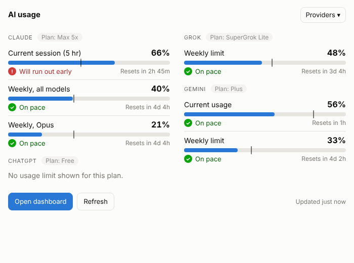
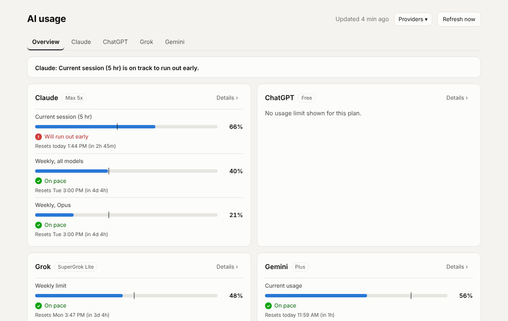
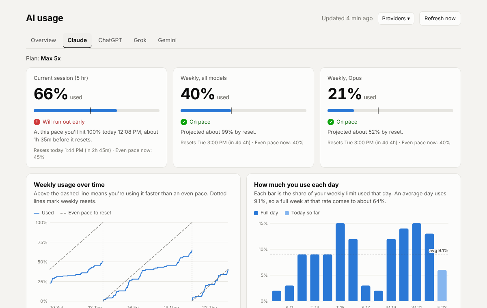

# AI Usage Tracker

A Chrome extension that shows how much of your AI plan you have used, how fast you are using it, and whether you will hit your limit before it resets. It works across Claude, ChatGPT, Grok and Gemini, and you choose which ones to track. Nothing is read until you turn a provider on.

Every provider shows your usage somewhere in its settings, but only as a number right now. The tracker takes a reading on a schedule, keeps the history, and uses it to predict where you will land at the reset, so a limit does not catch you in the middle of a piece of work.



## What it does

- **Predicts whether you will run out early.** For every limit it compares how much you have used with how much of the window has passed, projects your average pace forward to the reset, and labels the result: on pace, ahead of pace, cutting it close, or will run out early. When a run-out is coming it tells you roughly when you would hit 100%.
- **Shows every provider in one place.** The toolbar badge shows the percentage and color of the most urgent limit across everything you track, and hovering it lists each provider's worst limit.
- **Keeps your history.** The dashboard turns readings into trends: usage against an even-pace line, how much of your limit you use each day, which hours you work, and a plan check that tells you whether your plan fits.
- **Alerts you** at 75% and 90% of a weekly limit, 90% of a session, and when your pace says you will run out early. Alerts can be turned off on the dashboard.
- **Exports your data** as CSV or JSON, which is useful when you want evidence for a plan upgrade.
- **Syncs to your own Supabase database** if you want history across computers or want to query it.



## Providers

Each provider is opt-in from the **Providers** menu in the popup header or the top right of the dashboard. Turning one on asks Chrome for permission to read that site, and turning it off removes the permission. You must be signed in to each tool you track in the same Chrome profile.

| Provider | How it is read | What you see | Reading interval |
|---|---|---|---|
| Claude | The same usage numbers the Settings, Usage page uses, requested from your signed-in claude.ai session | 5 hour session, weekly all models, and any per-model weekly limits | 15 minutes |
| ChatGPT | The text of chatgpt.com/settings/usage, read in a background tab | Monthly limit on free plans, or 5 hour and weekly limits where the plan has them. Your plan is read from the billing page | 1 hour |
| Grok | The Usage panel on grok.com, read in a background tab | One weekly limit with a Voice and Chat split and any extra credits | 1 hour |
| Gemini | gemini.google.com/usage, read in a background tab | A current-usage meter and a weekly limit | 1 hour |

Your plan name is shown next to each provider in the popup and on its dashboard tab.

### Things worth knowing about each provider

- **Claude** reports percentages, not message or token counts, so everything is a percent of your limit. Free accounts have no usage numbers, so the extension shows a short note. If Claude does report a limit for a free account, it is shown like any other limit.
- **ChatGPT's usage page covers Codex, Work, agents and ChatGPT for Excel.** It does not include ordinary chat messages and ChatGPT reports no number for them, so the extension does not invent one. A free ChatGPT account reports no usage limit at all, so it is listed with its plan and a note saying there is nothing to track. Only the monthly layout has been checked against a real page, so 5 hour and weekly layouts for paid plans are untested. ChatGPT shows the reset as a rounded countdown such as "Resets in 30d 0h", so the extension keeps its estimate steady between readings.
- **Grok** has no usage API, so the extension reads the panel text. A redesign of that panel would show "Could not find the Usage panel on grok.com" while everything else keeps working.
- **Gemini** labels its first meter "Current usage" without saying how long its window is. The extension treats it as a 5 hour window, so the pace marker on that meter is an estimate. The weekly meter is a plain weekly limit.

Grok, Gemini and ChatGPT are read from page text, so a redesign of any of those pages can break that provider until the extension is updated. The dashboard shows an error for the affected provider and the others keep working.

## How the prediction works

For each limit the extension knows when the window resets and how long the window is, so it knows how far through it you are.

- **Pace** is the share of the window that has passed. If you are halfway through the week and at 60%, you are ahead of an even pace.
- **Projection** takes your average burn rate so far in the current window and carries it to the reset. If that lands above 100%, the extension also works out the time you would reach 100%.
- **Labels:** on pace when the projection is comfortably under the limit, ahead of pace when you are using more than an even share but have room, cutting it close when the projection lands right around 100%, and will run out early when it clearly lands over.
- **Too early to project:** long windows such as a monthly limit get no pace or projection for their first three days, because there is not enough history to say anything useful.

This is a straight line from your average, so a heavy burst early in a window makes it pessimistic and a quiet stretch makes it optimistic. It is a guide, not a guarantee.

## The toolbar badge

The badge shows the percentage of the single most urgent limit across every provider that is turned on, in the color of its state: green when things are fine, amber when you are ahead of pace or cutting it close, red when you will run out early or have hit the limit, and gray when there is nothing to project yet. Urgency runs from limit reached, to will run out early, to cutting it close, to ahead of pace, to fine, and ties go to the higher percentage.

Hovering the icon lists one line per provider with its worst limit, worst first:

```
ChatGPT: 5-hour usage limit 70% (will run out early)
Grok: Weekly limit 40%
Claude: Current session (5 hr) 24%
```

A short window that is on track to run out can outrank a calmer weekly figure on the badge, which is intentional. A gray `!` means the last reading failed and no provider has data yet.

## The dashboard

The dashboard opens on an **Overview** tab whenever two or more providers are on, with a one-line verdict and a card per provider for a quick glance. Each provider also has its own tab with the detail:

- Limit cards with percent used, status, projected percentage at reset, and when you would hit 100% if you are on track to run out
- Usage over the last 14 days compared with an even-pace line
- How much of your weekly limit you use each day, with your daily average
- Short-window usage over the last 48 hours
- Your usage by hour of day
- A plan check ("Plan fits", "Running tight" or "More plan than you need") based on your weekly peaks and how often you hit session limits



The charts become useful after a day or two of readings and the plan check after about a week. To preview everything with sample data before you have readings, click **Preview with sample data**, or open `dashboard.html?demo=1` from the extension.

## Install

1. Download or clone this repository.
2. Open `chrome://extensions` in Chrome.
3. Turn on **Developer mode** in the top right corner.
4. Click **Load unpacked** and select the folder that contains `manifest.json`. If Chrome says the manifest is missing, you picked a folder one level too high.
5. Click the puzzle piece icon in the toolbar and pin **AI Usage Tracker**.
6. A dashboard tab opens the first time. Choose the providers you use and allow the permission Chrome asks for. Make sure you are signed in to those sites, then press **Refresh** to take your first reading.

Keep the folder where it is after you install, because Chrome runs the extension from it. To update, replace the files and click the reload arrow on the extension's card in `chrome://extensions`.

Requirements: Google Chrome or another Chromium browser that supports Manifest V3 (Edge, Brave, Arc), and an account on at least one supported tool. There is no build step and no dependencies. It is plain JavaScript, HTML and CSS.

## Privacy and data storage

By default everything stays in your browser. Readings are saved in the extension's local storage in your Chrome profile and nothing is sent anywhere. About 120 days of history are kept, which is a few hundred KB.

Checking Claude usage does not use any of your allowance, since it is the same small request your browser makes when you open the Settings, Usage page. For the other providers the extension opens the usage page in a background tab, reads the text, and closes the tab.

If you turn on cloud sync, readings are also copied to the Supabase project you configure and nowhere else.

### Permissions

Site access is requested only when you turn that provider on and is removed when you turn it off.

| Permission | Why |
|---|---|
| `claude.ai`, `grok.com`, `gemini.google.com`, `chatgpt.com` (all optional) | Read usage for each provider, only once you turn it on |
| `https://*.supabase.co/*` | Send readings to your Supabase project, only if cloud sync is turned on |
| `storage` | Save your reading history locally |
| `alarms` | Take readings on a schedule |
| `notifications` | Send usage alerts |
| `tabs`, `scripting` | Read the usage pages in a background tab, and fall back to an open claude.ai tab if a direct request is blocked |

## Optional: cloud sync with Supabase

Cloud sync gives you history across computers and a database you can query. It also lets Claude answer questions like "how is my usage this week?" in any chat that has your Supabase connected.

1. In your Supabase project, run [`supabase/schema.sql`](supabase/schema.sql) in the SQL editor. It creates:
   - `aiusage_devices`: one row per person or browser, each with a secret ingest token
   - `aiusage_snapshots`: one row per reading, with the provider in the `tool` column
   - `aiusage_readings`: a view with one row per limit per reading, for easy querying
   - `aiusage_ingest`: the only write path. It requires a valid ingest token, and the tables are not readable through the public API.
2. Add yourself and copy the token:
   ```sql
   insert into public.aiusage_devices (owner_label) values ('your-name') returning ingest_token;
   ```
3. Build your sync code, which is base64-encoded JSON with your project URL, publishable key, ingest token and a name. In the browser console or Node:
   ```js
   btoa(JSON.stringify({
     u: "https://YOUR-PROJECT.supabase.co",
     k: "sb_publishable_...",
     t: "YOUR-INGEST-TOKEN",
     n: "your-name"
   }))
   ```
4. Open the dashboard, paste the code under **Cloud sync**, and click **Connect**. Your existing history uploads and new readings sync after each reading.

Treat the sync code like a password. It can only add readings, but anyone who has it can write to your table. Never commit it to the repository.

Example query:

```sql
select tool, limit_key, used_pct, resets_at, read_at
from aiusage_readings
where owner_label = 'your-name'
order by read_at desc
limit 10;
```

## How it is built

- `background.js` runs the alarms, reads each enabled provider, stores snapshots, updates the badge, sends alerts and syncs.
- `lib/providers.js` is the provider registry: names, notes, and what each provider's limits mean (label and window length).
- `lib/grok.js`, `lib/gemini.js` and `lib/chatgpt.js` read and parse each provider's page text. The in-page functions are self-contained because they are serialized into the page.
- `lib/core.js` holds all the calculations: windows and resets, pace, projection, daily and hourly usage, and the plan check. It has no browser dependencies, so it also runs in Node.
- `lib/menu.js` is the Providers menu shared by the popup and dashboard.
- `dashboard.html`, `dashboard.js`, `popup.html` and `popup.js` are the UI.
- `lib/charts.js` contains small hand-built SVG charts, since extension pages cannot load chart libraries from a CDN.
- `lib/ui.js` handles shared formatting and status wording, and `lib/demo.js` generates the sample data.

**Snapshot format:**

```json
{ "t": 1792188000000, "p": "claude", "l": { "seven_day": { "u": 46, "r": 1792508400000 } } }
```

`t` is the reading time, `p` is the provider (readings saved before multi-provider support have no `p` and count as Claude), `u` is the percent used from 0 to 100, and `r` is the reset time, all in epoch milliseconds.

## Known limitations

- **None of these are official usage APIs.** Claude's endpoint is what its own Settings page uses, and the other providers are read from page text. Any of them can change without notice. If a reading fails, the dashboard shows the error for that provider, and for Claude you can expand **Raw response from claude.ai** to see what came back.
- It is not in the Chrome Web Store, so you install it in Developer mode and it does not update automatically. Chrome may show a warning about developer-mode extensions on startup.
- Readings are only taken while Chrome is open and you are signed in to the tracked site. After a gap the totals catch up on the next reading, but you lose detail about when in the gap the usage happened.
- Usage cannot be broken down by app, because providers report account totals. Claude usage from the web, desktop app, mobile and Claude Code all appear together.
- The extension has been tested with simulated Chrome tests and in a real browser on a few accounts. Layouts for plans I have not had access to, such as paid ChatGPT plans, are untested.

## Troubleshooting

| Problem | Fix |
|---|---|
| "Manifest file is missing or unreadable" | Select the folder that directly contains `manifest.json` |
| "Not signed in" for a provider | Sign in to that site in the same Chrome profile, then press Refresh |
| A provider does not turn on from the popup | Open the dashboard and turn it on from the Providers menu there, then approve the permission Chrome asks for |
| Claude readings fail with an HTTP error | Open a claude.ai tab and press Refresh. The extension can read through an open tab. |
| "Could not find the usage meters" for Grok, Gemini or ChatGPT | The provider changed its page. Open an issue and say which provider and what you see. |
| A provider shows "No usage limit shown for this plan" | Expected on plans that have no usage limit, such as a free ChatGPT account |
| Cloud sync shows an error | Check that the sync code was copied completely and that `schema.sql` was run in that project |
| Badge shows `!` | The last reading failed. Open the popup to see why. |

## Roadmap

- Estimating ordinary ChatGPT chat usage from message counts, since ChatGPT does not report it
- More providers
- Team view for admins using the official Anthropic and OpenAI usage APIs
- Chrome Web Store release

## Contributing

Issues and pull requests are welcome. When a provider stops working, the most useful report is which provider it is, which plan you are on, and what the usage page looks like.
