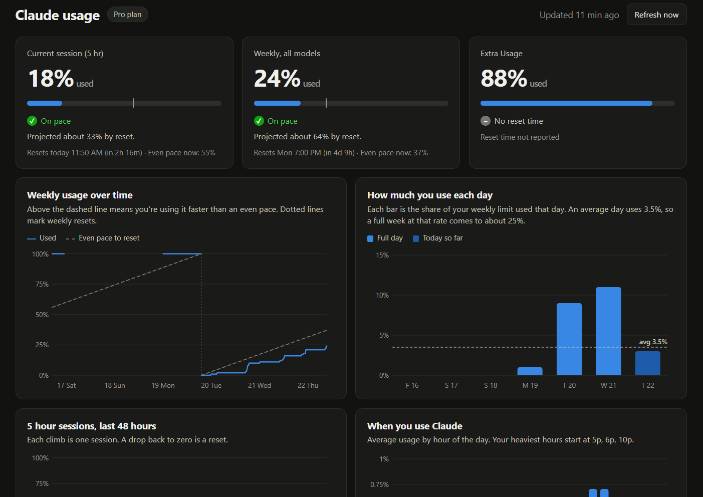

# AI Usage Tracker

A Chrome extension that keeps a running history of your Claude plan usage so you can see how fast you're using it, whether you'll run out before your limit resets, and whether your plan is the right size.

Claude's Settings, Usage page shows where you are right now. It doesn't show how you got there or where you're headed. This extension takes a reading every 15 minutes, saves it, and turns the history into trends, pace and projections.



## What it does

- **Toolbar badge** shows your weekly usage percentage, colored by pace: green when you're on pace, amber when you're ahead of pace or cutting it close, red when you're on track to run out early.
- **Popup** lists every limit (5 hour session, weekly all models, and any per-model weekly caps) with a usage bar, a marker for where an even pace would put you, and time until reset.
- **Dashboard** with:
  - Limit cards showing percent used, status, the projected percentage at reset, and when you'd hit 100% if you're on track to run out
  - Weekly usage over the last 14 days compared with an even-pace line
  - How much of your weekly limit you use each day, with your daily average
  - 5 hour session usage over the last 48 hours
  - Your usage by hour of day
  - A plan check ("Plan fits", "Running tight", or "More plan than you need") based on your weekly peaks and how often you hit session limits
- **Alerts** at 75% and 90% of a weekly limit, 90% of a session, and when your weekly pace says you'll run out early. You can turn them off on the dashboard.
- **Export** your full history as CSV or JSON.
- **Optional cloud sync** to your own Supabase database, so you can query your history or ask Claude about it from any chat.

## What it tracks (and what it doesn't)

The extension reads the same numbers as claude.ai's Settings, Usage page. Those are account totals, so usage from claude.ai on the web, the desktop app, mobile and Claude Code all show up.

A few limits apply:

- It can't break usage down by app, because Claude doesn't report that.
- It only takes readings while Chrome is open. If Chrome is closed for a while, the totals catch up on the next reading, but you lose detail about when in that gap the usage happened.
- Claude reports percentages, not message or token counts, so everything here is in percent of your limit.
- ChatGPT isn't supported yet.

## Requirements

- Google Chrome, or another Chromium browser that supports Manifest V3 extensions (Edge, Brave, Arc)
- A paid Claude plan (Pro, Max, or Team) that shows usage limits under Settings, Usage. Free plans and Enterprise plans billed by spend don't have these limits to track.
- You must be signed in to claude.ai in the same Chrome profile
- Optional: a Supabase project, if you want cloud sync

There's no build step and no dependencies. It's plain JavaScript, HTML and CSS.

## Install

1. Download or clone this repository.
2. Open `chrome://extensions` in Chrome.
3. Turn on **Developer mode** in the top right corner.
4. Click **Load unpacked** and select the folder that contains `manifest.json`. If Chrome says the manifest is missing, you picked a folder one level too high.
5. Click the puzzle piece icon in the toolbar and pin **AI Usage Tracker**.
6. Make sure you're signed in to claude.ai, then click the extension icon and press **Refresh** to take your first reading.

Keep the folder where it is after you install. Chrome runs the extension from that folder, so moving or deleting it breaks the extension. To update, replace the files and click the reload arrow on the extension's card in `chrome://extensions`.

The charts become useful after a day or two of readings. The plan check becomes reliable after about a week.

To preview the dashboard with sample data before you have readings, open the dashboard and click **Preview with sample data**, or open `dashboard.html?demo=1` from the extension.

## Privacy and data storage

By default, everything stays in your browser. Readings are saved in the extension's local storage in your Chrome profile, and nothing is sent anywhere. About 120 days of history are kept, which is a few hundred KB.

Checking usage doesn't use any of your Claude allowance. It's the same small request your browser makes when you open the Settings, Usage page.

If you turn on cloud sync, readings are also copied to the Supabase project you configure, and nowhere else.

### Permissions

| Permission | Why |
|---|---|
| `https://claude.ai/*` | Read your usage numbers from your signed-in claude.ai session |
| `https://*.supabase.co/*` | Send readings to your Supabase project, only if cloud sync is turned on |
| `storage` | Save your reading history locally |
| `alarms` | Take a reading every 15 minutes |
| `notifications` | Send usage alerts |
| `tabs`, `scripting` | Fall back to reading usage through an open claude.ai tab if a direct request is blocked |

## Optional: cloud sync with Supabase

Cloud sync gives you history across computers and a database you can query. It also lets Claude answer questions like "how's my Claude usage this week?" in any chat that has your Supabase connected.

1. In your Supabase project, run [`supabase/schema.sql`](supabase/schema.sql) in the SQL editor. It creates:
   - `aiusage_devices`: one row per person or browser, each with a secret ingest token
   - `aiusage_snapshots`: one row per reading
   - `aiusage_readings`: a view with one row per limit per reading, for easy querying
   - `aiusage_ingest`: the only write path. It requires a valid ingest token, and the tables aren't readable through the public API.
2. Add yourself and copy the token:
   ```sql
   insert into public.aiusage_devices (owner_label) values ('your-name') returning ingest_token;
   ```
3. Build your sync code, which is base64-encoded JSON with your project URL, publishable key, ingest token and a name. In the browser console or Node:
   ```js
   btoa(JSON.stringify({
     u: "https://YOUR-PROJECT.supabase.co",
     k: "sb_publishable_...",
     t: "YOUR-INGEST-TOKEN",
     n: "your-name"
   }))
   ```
4. Open the dashboard, paste the code under **Cloud sync**, and click **Connect**. Your existing history uploads, and new readings sync after each 15-minute reading.

Treat the sync code like a password. It can only add readings, but anyone who has it can write to your table. Never commit it to the repository.

Example query:

```sql
select limit_key, used_pct, resets_at, read_at
from aiusage_readings
where owner_label = 'your-name'
order by read_at desc
limit 10;
```

## How it works

- `background.js` runs on a 15-minute alarm. It finds your Claude organization, calls the usage endpoint, stores a snapshot, updates the badge, sends alerts and syncs if cloud sync is on.
- `lib/core.js` holds all the calculations: parsing, usage windows and resets, pace, projections, daily and hourly usage, and the plan check. It has no browser dependencies, so it also runs in Node.
- `dashboard.html`/`dashboard.js` and `popup.html`/`popup.js` are the UI.
- `lib/charts.js` contains small hand-built SVG charts. Extension pages can't load chart libraries from a CDN.
- `lib/ui.js` handles shared formatting and status wording.
- `lib/demo.js` generates sample data for the preview.

**Pace and projection:** For each limit, the extension compares how much you've used with how much of the window has passed. If you're halfway through the week and at 60%, you're ahead of an even pace. The projection assumes you keep using it at this window's average rate so far.

**Snapshot format:**

```json
{ "t": 1792188000000, "l": { "seven_day": { "u": 46, "r": 1792508400000 } } }
```

`t` is the reading time, `u` is the percent used (0 to 100), and `r` is the reset time, all in epoch milliseconds.

## Known limitations

- **The usage endpoint isn't an official API.** It's what claude.ai's own Settings page uses, and Anthropic can change it without notice. The parser looks for any limit with a `utilization` value to give it some resilience. If readings start failing, open the dashboard and expand **Raw response from claude.ai** to see what came back.
- It isn't in the Chrome Web Store, so you install it in Developer mode and it doesn't update automatically. Chrome may show a warning about developer-mode extensions on startup.
- Readings stop while Chrome is closed or while you're signed out of claude.ai.

## Troubleshooting

| Problem | Fix |
|---|---|
| "Manifest file is missing or unreadable" | Select the folder that directly contains `manifest.json` |
| "Not signed in to claude.ai" | Sign in to claude.ai in the same Chrome profile, then press Refresh |
| Readings fail with an HTTP error | Open a claude.ai tab and press Refresh. The extension can read through an open tab. |
| Cloud sync shows an error | Check that the sync code was copied completely and that `schema.sql` was run in that project |
| Badge shows `!` | The last reading failed. Open the popup to see why. |

## Roadmap

- ChatGPT support. ChatGPT doesn't expose usage, so this would be estimated from message counts.
- Team view for admins using the official Anthropic and OpenAI usage APIs
- Chrome Web Store release